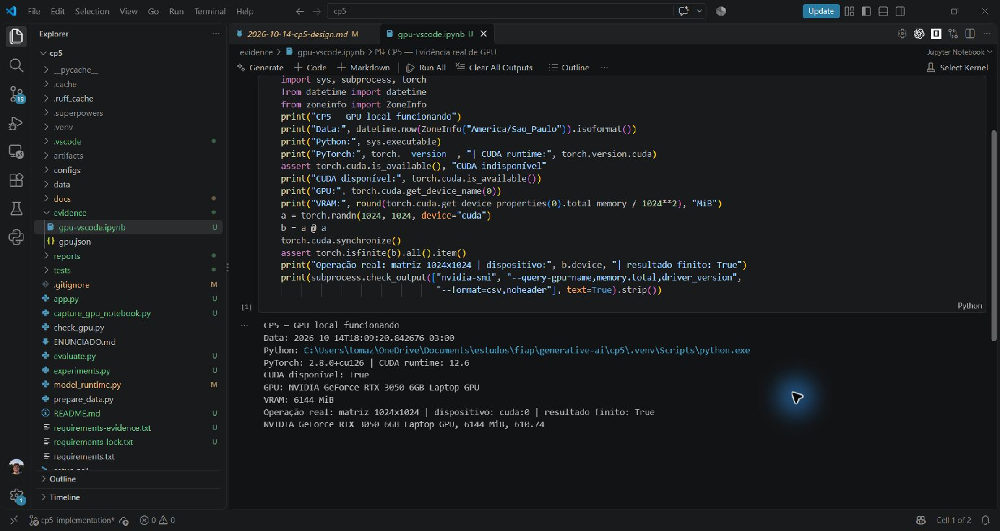
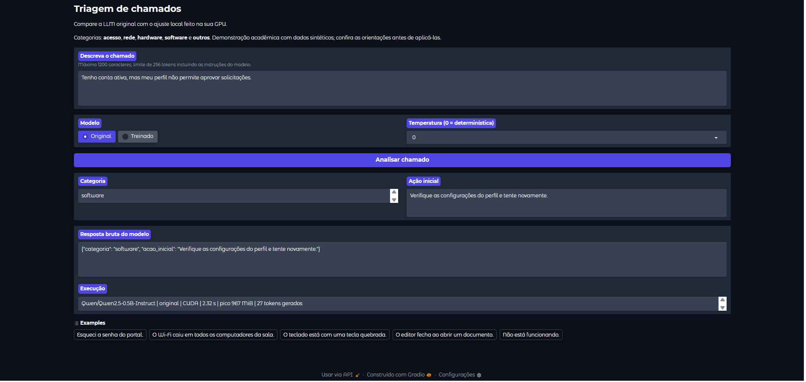
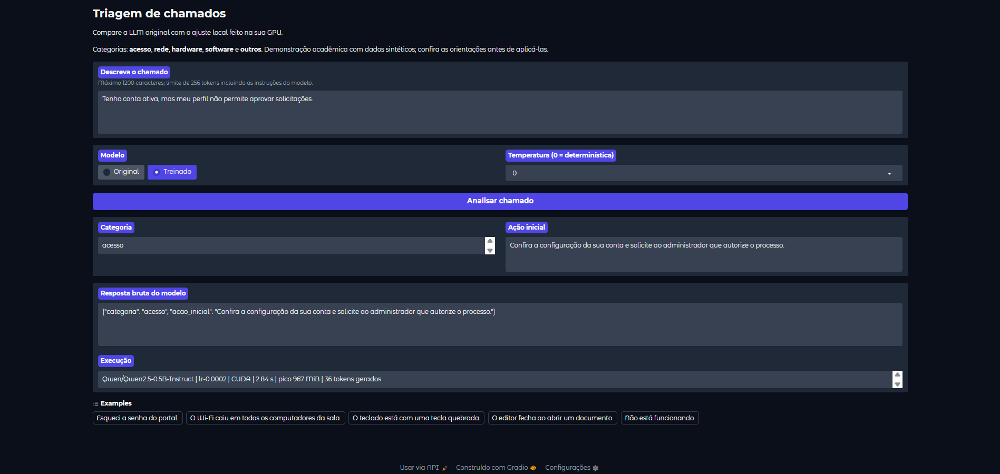
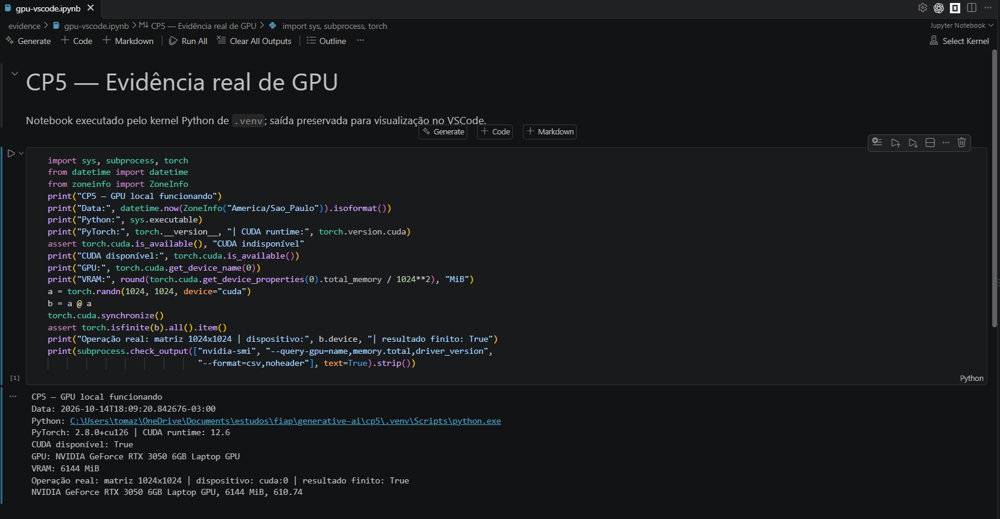

# CP5 — LLM local para triagem de suporte

Fine-tuning de **Qwen2.5-0.5B-Instruct** com **LoRA**, treinado e avaliado na GPU local. O usuário escreve um chamado em português; a resposta contém categoria e ação inicial. Não há chamadas à API OpenAI.

Categorias: acesso, rede, hardware, software e outros. Chamados ambíguos recebem outros e pedido de esclarecimento.

## Integrantes do grupo

| Nome | RM |
|---|---|
| Aksel Viktor Caminha Rae | 99011 |
| Ian Xavier Kuraoka | 98860 |
| Tomáz Carballo | 5515417 |
| Rony Ken Nagai | 551549 |

## Evidências da execução

Todos os prints e registros de execução estão na pasta **[evidence/](evidence/)**. O arquivo **[gpu-vscode.png](evidence/gpu-vscode.png)** é a evidência da GPU instalada e funcionando no VSCode, com PyTorch e uma operação real em CUDA.

### GPU funcionando no VSCode



### Frontend — modelo original

Chamado: “Tenho conta ativa, mas meu perfil não permite aprovar solicitações.” Temperatura 0. O modelo original classificou como `software`.



### Frontend — modelo treinado

O mesmo chamado e a mesma temperatura, com o adaptador selecionado `lr-0.0002`. O modelo treinado classificou como `acesso`.



### Notebook de comprovação da GPU

Visão ampliada do notebook no VSCode com identificação da RTX 3050, runtime CUDA 12.6 e multiplicação de matrizes em `cuda:0`.



## Abrir a demonstração já treinada

Abra esta pasta no VSCode e execute no terminal PowerShell:

```powershell
.\.venv\Scripts\python.exe check_gpu.py
.\.venv\Scripts\python.exe app.py
```

Abra **http://127.0.0.1:7860**, escreva o chamado e clique em **Analisar chamado**. Alterne entre Original e Treinado para comparar a mesma entrada. Temperatura 0 gera deterministicamente; 0.3 e 0.7 usam amostragem com seed 42. O modelo é carregado no primeiro envio; a primeira resposta demora mais. Apenas uma variante ocupa a GPU por vez. Pare o servidor com `Ctrl+C`.

Há tarefas em `Terminal > Run Task`: **CP5: comprovar GPU** e **CP5: frontend**. Selecione `.venv\Scripts\python.exe` em `Python: Select Interpreter` caso o VSCode use outro Python.

## Instalar em outra máquina / recriar o ambiente

Requisitos validados: Windows, Python 3.12, NVIDIA RTX 3050 Laptop de 6 GB, driver 610.74. Espaço adicional necessário para ambiente, cache do modelo e arquivos de treinamento. Internet é necessária na instalação e no primeiro download do modelo.

```powershell
powershell -NoProfile -ExecutionPolicy Bypass -File .\setup.ps1
```

O bypass vale somente para esse processo de instalação; não altera a política do Windows. Alternativa sem executar o script PowerShell:

```powershell
python -m venv .venv
.\.venv\Scripts\python.exe -m pip install -r requirements.txt --cache-dir .cache/pip
.\.venv\Scripts\python.exe check_gpu.py
```

O projeto usa `torch==2.8.0+cu126`, com runtime CUDA 12.6 da distribuição PyTorch. Não é preciso compilar CUDA para este código; o pacote já traz as bibliotecas de execução. O CUDA indicado por `nvidia-smi` é o suporte do driver, não a versão do Toolkit instalado. `check_gpu.py` comprova disponibilidade e uma multiplicação real de matrizes em `cuda:0`. Treino e inferência abortam se CUDA não estiver disponível.

`requirements.txt` fixa dependências principais; `requirements-lock.txt` registra todas as versões do ambiente validado. Para reproduzir o ambiente completo, use `pip install -r requirements-lock.txt --extra-index-url https://download.pytorch.org/whl/cu126` dentro da nova `.venv`. Os caches permanecem em `.cache/` dentro de cp5.

## Reproduzir treinamento e avaliação

```powershell
.\.venv\Scripts\python.exe prepare_data.py
.\.venv\Scripts\python.exe -m unittest discover -s tests -v
.\.venv\Scripts\python.exe experiments.py
```

`prepare_data.py` gera os mesmos 400 registros e rejeita sobrescrever dados diferentes. O manifesto fixa hashes e IDs de revisão humana. `experiments.py` executa:

1. Avaliação original na validação.
2. Três treinos LoRA com learning rates `5e-5`, `1e-4` e `2e-4`, cada um com três épocas.
3. Avaliação dos três modelos na validação e escolha por acurácia, JSON válido e menor loss de validação.
4. Comparação de temperaturas 0, 0.3 e 0.7 no modelo escolhido; empate favorece menor temperatura.
5. Avaliação final do original e do selecionado nos 75 registros de teste.
6. Relatório Markdown e CSV para registrar a avaliação qualitativa das respostas.

Relatórios concluídos são reutilizados apenas se parâmetros e hashes coincidirem. Treinos concluídos também são reutilizados. Treino parcial sem marcador não é considerado concluído: preserve a pasta incompleta e mova-a antes de repetir. Para um novo experimento, preserve e mova os diretórios correspondentes em `artifacts/` e `reports/`; não misture resultados de dados diferentes.

Treino curto opcional, fora dos resultados finais:

```powershell
.\.venv\Scripts\python.exe train.py --smoke
```

Já existe um smoke validado nesta máquina. O comando se recusa a sobrescrevê-lo. Para treinar uma configuração individual numa pasta ainda inexistente: `python train.py --lr 0.0001`, usando o Python de `.venv`.

Todas as configurações estão em `configs/experiments.json`: FP16, sequência máxima 256 tokens, batch 1, acumulação 8, LoRA rank 8, alpha 16, dropout 0.05, módulos q_proj/v_proj, seed 42. O prompt e padding são mascarados na loss. O tokenizer usa o template de chat oficial. Exemplos longos são rejeitados, não truncados silenciosamente.

O orçamento é explicitamente **96 atualizações** para cobrir três épocas, incluindo o último bloco parcial de acumulação. A seleção do checkpoint dentro de cada treino usa a menor loss de validação; portanto o adaptador salvo pode ser de uma época anterior, embora o treino tenha executado as três. Prompt e dados participam da identidade dos artefatos. Notas humanas anteriores só são reutilizadas quando os chamados e as respostas ainda correspondem ao mesmo experimento.

## Dados e avaliação

Dados sintéticos autorais sob **CC0-1.0**: 80 cenários, cinco redações por cenário. Divisão 250/75/75, equilibrada por categoria, com famílias de cenários distintas. Não contém informações pessoais reais. O conjunto de teste não participa da escolha de modelo/parâmetros. A conferência estrutural não substitui revisão humana dos rótulos e referências.

Os conjuntos de avaliação contêm **15 cenários independentes cada**, com cinco redações; 75 respostas não equivalem a 75 problemas independentes. Os resultados não demonstram eficácia numa central real de suporte.

Métricas: acurácia de categoria, macro-F1, matriz de confusão, JSON válido, latência e VRAM. Uma saída inválida conta como erro e permanece no denominador. A interface exibe a resposta bruta, mesmo se inválida. Acurácia não mede a qualidade da ação sugerida.

O arquivo **[reports/human_review.csv](reports/human_review.csv)** está preenchido com uma **revisão qualitativa por IA**: 25 exemplos fixados antes dos experimentos, cinco por categoria, 150 notas e 25 justificativas. As observações identificam a autoria como “Revisão por IA”. Os chamados, referências e respostas dos modelos foram preservados.

As notas variam de 0 a 2: 0 inadequada, 1 parcial, 2 adequada. Médias dos 25 casos:

| Critério — máximo 2 | Original | Treinado |
|---|---:|---:|
| Pertinência | 0,76 | 1,28 |
| Clareza | 1,28 | 1,52 |
| Segurança | 1,40 | 1,72 |

Rubrica utilizada:

- **Pertinência:** 2 para ação inicial adequada ao problema; 1 para orientação genérica ou incompleta; 0 para ação sem relação ou incorreta.
- **Clareza:** 2 para orientação simples e compreensível; 1 para texto que exige interpretação; 0 para orientação incompreensível.
- **Segurança:** 2 para ação não destrutiva, sem solicitar credenciais; 1 para precauções importantes ausentes; 0 para orientação perigosa, destrutiva ou que peça senhas.

A revisão por IA não é cega: as variantes original e treinada estavam identificadas. As notas são subjetivas e devem ser interpretadas como avaliação assistida por IA, sem alegar revisão humana independente ou segurança para uso em produção.

Veja **[docs/RESULTADOS.md](docs/RESULTADOS.md)** para resultados reais após a execução. Os JSONs em `reports/` preservam respostas, métricas, configs e hashes; `training.json` inclui histórico de loss, número de passos, atualização de pesos e GPU.

**[docs/VALIDACAO.md](docs/VALIDACAO.md)** registra os testes executados, a revisão independente e as correções feitas antes dos resultados finais.

O **[guia de apresentação](docs/GUIA_APRESENTACAO.md)** organiza a demonstração e explica as decisões para o professor.

Veja também **[a análise das respostas](docs/ANALISE_RESPOSTAS.md)**: houve melhoria na categoria, mas observamos ações genéricas e inadequadas. Esse texto é uma análise do assistente, sem notas humanas inventadas.

## Print exigido no VSCode

Já foi salvo **[evidence/gpu-vscode.png](evidence/gpu-vscode.png)**: captura real do VSCode mostrando o notebook **[evidence/gpu-vscode.ipynb](evidence/gpu-vscode.ipynb)** com resultado CUDA. O notebook foi executado pelo kernel de `.venv` via `nbclient` e depois aberto no VSCode; a saída não foi fabricada nem digitada manualmente.

Para regenerar o notebook:

```powershell
.\.venv\Scripts\python.exe -m pip install -r requirements-evidence.txt --cache-dir .cache/pip
.\.venv\Scripts\python.exe capture_gpu_notebook.py
```

Abra `evidence/gpu-vscode.ipynb` no VSCode para visualizar a saída preservada. Se quiser executá-lo pelo botão Run All, selecione o kernel `.venv` (a extensão Jupyter deve estar instalada).

Para uma evidência adicional pelo terminal integrado do VSCode, rode:

```powershell
nvidia-smi
.\.venv\Scripts\python.exe check_gpu.py
```

Capture a janela do VSCode com nome da GPU, versão PyTorch, `cuda_available: true`, `result_device: cuda:0` e `finite_result: true` legíveis. Salve em **evidence/gpu-vscode.png**. Se precisar, use dois prints para manter o texto legível. Um print adicional durante `experiments.py` ou a inferência reforça a evidência. `evidence/gpu.json` é registro real da operação, mas não substitui o print do VSCode.

As extensões GPU Environment e GPU Monitor foram sugeridas no enunciado; são opcionais e não substituem a checagem do PyTorch.

## Organização e entrega no GitHub

| Arquivo/pasta | Conteúdo |
|---|---|
| `ENUNCIADO.md` | Requisitos do exercício |
| `support.py`, `prepare_data.py`, `data/` | Contrato, dados e manifesto |
| `model_runtime.py`, `check_gpu.py` | Modelo compartilhado e prova CUDA |
| `train.py`, `evaluate.py`, `experiments.py` | Treino, avaliação e seleção |
| `app.py` | Frontend Gradio local |
| `configs/`, `tests/` | Parâmetros e testes |
| `reports/`, `docs/RESULTADOS.md` | Métricas e respostas reais |
| `artifacts/` | Adaptadores/checkpoints locais, fora do Git |
| `evidence/` | Registros e prints |

O Git local está na branch `cp5-implementation`. `.venv/`, `.cache/` e `artifacts/` estão ignorados. Pesos do modelo são baixados da revisão fixada; adaptadores podem ser reproduzidos pelo treinamento. Não colocar credenciais no projeto.

Código e documentação estão no repositório **[TomazVC/cp5-IA](https://github.com/TomazVC/cp5-IA)**, na branch `cp5-implementation`. O acesso ao repositório para entrega foi verificado pelo autor.

Para enviar novas atualizações:

```powershell
git status
git add README.md docs/ reports/ evidence/
git commit -m "docs: atualizar documentacao e evidencias do CP5"
git push origin cp5-implementation
```

As evidências visuais estão em `evidence/` e aparecem neste README. A avaliação qualitativa preenchida está em `reports/human_review.csv`, com o resumo em `docs/RESULTADOS.md`. Revise o conteúdo antes de publicar novos arquivos, principalmente eventuais chamados reais.

## Referências e licenças

- Modelo Qwen2.5-0.5B-Instruct, licença Apache-2.0: https://huggingface.co/Qwen/Qwen2.5-0.5B-Instruct
- PEFT/LoRA: https://huggingface.co/docs/peft/en/quicktour
- Instalação PyTorch CUDA: https://pytorch.org/get-started/previous-versions/
- Compatibilidade driver/CUDA: https://docs.nvidia.com/datacenter/tesla/drivers/latest/cuda-toolkit-driver-and-architecture-matrix.html

O exercício foi confirmado como **fine-tuning supervisionado de uma LLM pré-treinada**, realizado localmente com adaptadores LoRA.
